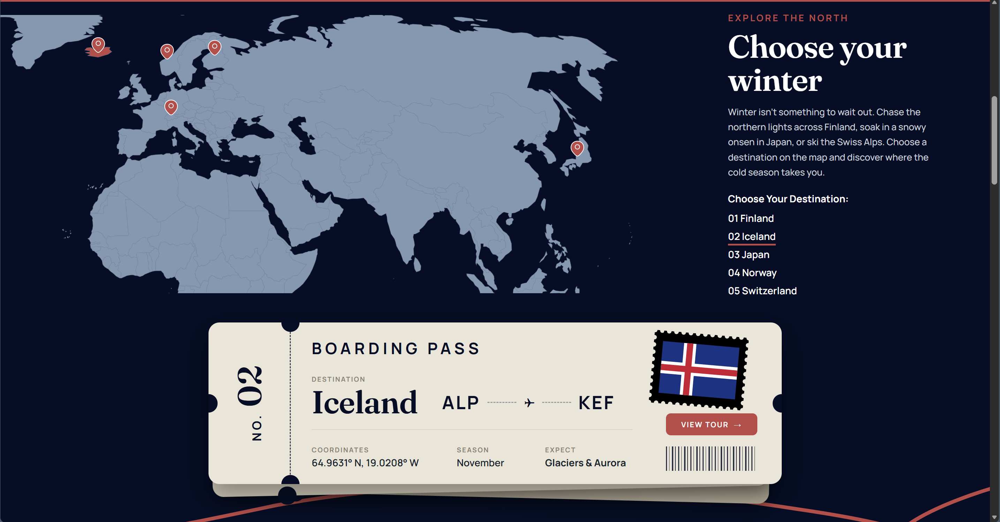

# ALPINES

A winter travel web application focused on five destinations: Finland, Iceland, Japan, Norway and Switzerland.

The project started as a front-end build using HTML, CSS and vanilla JavaScript, so I could understand the underlying layout, interaction and DOM logic without relying on frameworks. It is planned to grow into a full-stack web application.

> **Status:** work in progress. The desktop home page is complete. Explore, Packages, responsive layouts and backend functionality are planned next.

**Live demo:** https://ayaelhage.github.io/Alpines/

<p align="center">
  
</p>

## About

ALPINES is designed around winter-specific travel rather than treating winter as an off-season.

Users can explore five destinations through an interactive world map, select countries, and receive destination information through a custom boarding-pass interface.

The project will eventually expand into detailed destination pages, travel packages, user accounts and database-driven content.

## What's on the home page

- Full-screen destination hero slider
- Interactive SVG world map
- Clickable country pins and destination selector
- Dynamic boarding pass that updates with the selected country
- Custom CSS-based ticket design
- Packages carousel with category icons that light up for each package
- Stats strip with count-up numbers
- Vanilla JavaScript interactions without third-party UI libraries

## Built with

- HTML5, CSS3 (Grid, Flexbox, custom properties, `clamp()`)
- Vanilla JavaScript (DOM, Pointer Events, IntersectionObserver)
- Inline SVG (map and icons)
- Google Fonts: Fraunces and Manrope

## What I worked through

**1. Interactive SVG map and synchronized state**
- The map is loaded through an `<object>` element and manipulated with JavaScript.
- I used the SVG country paths to highlight selected destinations and position the map pins.
- Selecting a destination from the map, a pin or the country list updates the same state, which controls the map highlight and the boarding-pass information.

**2. Endless carousel without a library**
- The cards are rendered three times. After each move, the track silently jumps back to the middle set, so it feels infinite.
- The active card is centred using its measured `offsetLeft` and width.

**3. Performance and layout debugging**
- The carousel lagged on my laptop. I traced it to CSS masks on moving layers, extra `will-change` layers and large decoded photos, and replaced the masks with gradient overlays.
- I built at 80% browser zoom, and at 100% the map and ticket no longer fit. I fixed it by sizing the map from its SVG `viewBox` proportions and tying heights to the viewport height.

## Roadmap

- [x] Desktop home page
- [ ] Explore, Packages (with category filtering), About, Log in / Sign up and Profile pages
- [ ] Mobile and tablet layouts
- [ ] Working newsletter form
- [ ] Accessibility pass (focus states, alt text, contrast)
- [ ] Deploy to GitHub Pages
- [ ] Backend API and database integration
- [ ] User authentication
- [ ] Full-stack deployment

Detailed documentation (site structure, planned features, backend architecture and design decisions) will be added in Notion.

## Run locally

1. Clone the repository:

   ```bash
   git clone https://github.com/ayaelhage/ALPINES.git
   cd ALPINES
   ```

2. Open the project in VS Code and launch `index.html` with the Live Server extension. A local server is recommended because the interactive SVG map is loaded through an `<object>` element.

## Project structure

```
ALPINES/
├── index.html
├── style.css
├── script.js
├── assets/
├── screenshots/
│   └── map-ticket.png
└── README.md
```

## Credits

Photography, icons and external SVG assets will be credited here before final deployment.

## Author

Aya Hage, [@ayaelhage](https://github.com/ayaelhage)